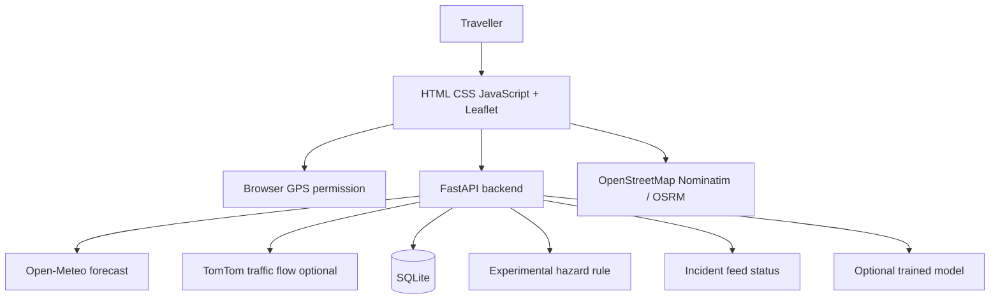

# SafeRoute AI — Project Overview

## Abstract
SafeRoute AI is a route-planning prototype that displays available route options and combines them with forecast weather, optional current traffic flow, and explicit incident/hazard availability states. It aims to help travellers consider conditions before leaving while clearly communicating uncertainty.

## Problem statement
Ordinary route planning can show distance and travel time without bringing all relevant weather and hazard context into one view. Data feeds can also be incomplete or unavailable, so a responsible system must avoid treating missing data as safe conditions.

## Objectives
- Display routes on an interactive map.
- Use browser GPS with permission and manual address search.
- Show future hourly Open-Meteo precipitation/weather data.
- Optionally query TomTom traffic flow with a private API key.
- Provide transparent experimental rainfall rules and explicit UNKNOWN states.
- Persist basic route history locally in SQLite.
- Provide a maintainable ML training scaffold without fabricated model claims.

## Existing system and limitations
Conventional maps commonly focus on navigation and ETA; provider coverage and availability vary. This prototype does not replace official road closure or disaster warning systems and does not provide verified comprehensive accident/landslide prediction.

## Proposed system and modules
1. Frontend: HTML, CSS, JavaScript, Leaflet, browser geolocation and speech APIs.
2. Backend: FastAPI validates requests and calls provider services.
3. Route module: public OSRM demo routing for car mode.
4. Weather module: future hourly Open-Meteo forecast.
5. Traffic module: optional TomTom flow endpoint, UNKNOWN if no readings.
6. Incident module: explicit unavailable state until a verified provider schema is configured.
7. Hazard module: experimental rainfall-only rule, not landslide prediction.
8. Database: SQLite history and observations schema.
9. ML scaffold: generic labelled-CSV training pipeline; no model is shipped.

## Architecture

## Limitations and future enhancements
- Add a licensed route provider with genuine car, bike, and pedestrian profiles.
- Integrate an incident feed only after verifying account entitlement, endpoint, and schema.
- Add official elevation, slope, geology and historical hazard datasets.
- Add route-corridor sampling and freshness checks for all data feeds.
- Train and time-validate models on verified, geographically appropriate data.
- Add privacy controls and production CORS restrictions.
